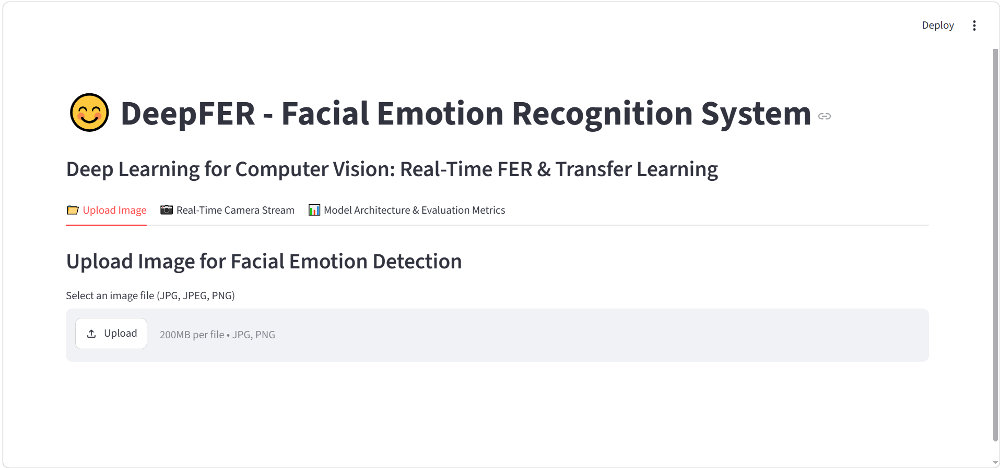
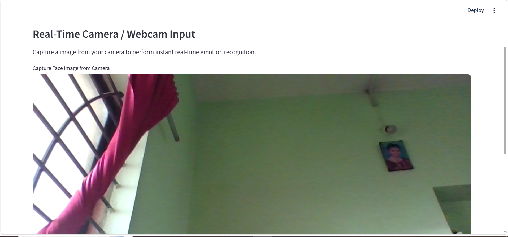
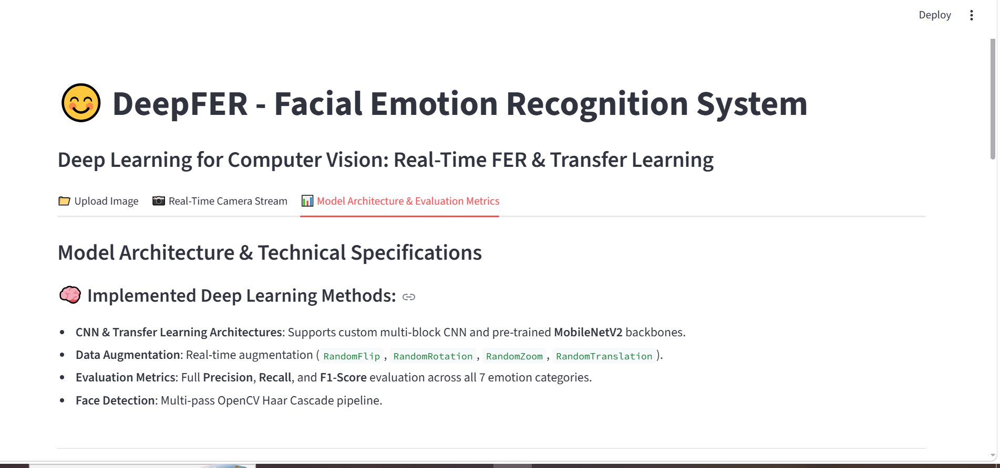
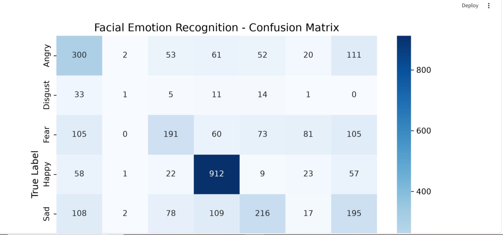

# 🧠 DeepFER — Deep Facial Emotion Recognition

**DeepFER** is a deep learning-based Facial Emotion Recognition system built using **Python, TensorFlow/Keras, OpenCV, and Streamlit**.

It detects faces in images and uses a Convolutional Neural Network (CNN) to classify facial expressions into seven emotion categories:

😠 Angry · 🤢 Disgust · 😨 Fear · 😊 Happy · 😢 Sad · 😲 Surprise · 😐 Neutral

This project demonstrates an end-to-end computer vision workflow, including face detection, image processing, CNN model training, emotion prediction, and interactive visualization.

---

## ✨ Key Features

- 🎯 **Face Detection:** Detects faces using OpenCV Haar Cascade.
- 🧠 **Deep Learning:** Uses a custom CNN architecture built with TensorFlow/Keras.
- 🎭 **Seven Emotion Categories:** Classifies facial expressions into seven predefined classes.
- 🌐 **Interactive Web App:** Provides a Streamlit dashboard for image-based predictions.
- ⚡ **CLI Prediction:** Supports predictions directly from the terminal.
- 🔄 **Model Training:** Includes a training pipeline to train or retrain the CNN.
- 📊 **Visualization:** Provides utilities for visualizing prediction probabilities and charts.

---

## 🛠️ Technologies & Tools Used

| Technology | Purpose |
|---|---|
| 🐍 Python | Core programming language |
| 🧠 TensorFlow / Keras | Deep learning and CNN model |
| 👁️ OpenCV | Face detection and image processing |
| 🌐 Streamlit | Interactive web application |
| 🔢 NumPy | Numerical operations |
| 📊 Matplotlib | Data visualization |
| ⚡ uv | Dependency and environment management |

---

## 📁 Project Architecture & Structure

```text
DeepFER/
├── app/
│   └── streamlit_app.py      # Streamlit Web UI Dashboard
├── data/
│   ├── raw/                  # Original dataset (train/ and test/)
│   └── processed/            # Processed dataset
├── models/
│   └── emotion_model.keras   # Saved Keras model
├── src/
│   ├── __init__.py           # Package initialization
│   ├── config.py             # Project configuration
│   ├── face_detector.py      # OpenCV face detection pipeline
│   ├── model.py              # CNN architecture
│   ├── predict.py            # Prediction pipeline and CLI
│   └── train.py              # Model training pipeline
├── utils/
│   ├── __init__.py           # Utilities package
│   └── visualization.py      # Visualization helpers
├── pyproject.toml            # Project configuration
├── requirements.txt          # Python dependencies
└── README.md                 # Project documentation
```

---

## 🧠 Model Architecture

DeepFER uses a custom **Convolutional Neural Network (CNN)** designed for facial expression classification.

### 🔹 Convolutional Blocks

- 3 convolutional blocks.
- 2 Conv2D layers in each block.
- 3 × 3 convolution filters.
- ReLU activation functions.
- Batch Normalization.
- Max Pooling (2 × 2).
- Dropout (0.25) for regularization.

### 🔹 Classification Head

- Flatten layer.
- Dense layer with 256 units.
- Batch Normalization.
- Dropout (0.5).
- Seven-class Softmax output layer.

### 🔹 Training Configuration

- **Optimizer:** Adam
- **Learning Rate:** Reduced on plateau.
- **Early Stopping:** Helps prevent overfitting.
- **Output:** Seven emotion classes.

---

## ⚡ Installation & Setup Using `uv`

### 📌 Prerequisites

- Python installed on your system.
- Git.
- VS Code or another Python editor.
- uv package manager.

### 1️⃣ Clone the Repository

```bash
git clone https://github.com/chaithranarendrabhandarkar2004/DeepFER.git

cd DeepFER
```

### 2️⃣ Install & Sync Dependencies

```bash
uv sync
```

This creates a virtual environment (`.venv`) and installs the dependencies configured in `pyproject.toml`.

### 3️⃣ Configure Python Interpreter in VS Code

1. Press `Ctrl + Shift + P`.
2. Search for **Python: Select Interpreter**.
3. Select the interpreter inside the `.venv` directory.

**Windows:**
```text
.venv\Scripts\python.exe
```

**Linux/macOS:**
```text
.venv/bin/python
```

---

## 🚀 Running the Project

### 🌐 Option 1: Launch Streamlit Web Application

```bash
uv run streamlit run app/streamlit_app.py
```

### 🖼️ Option 2: Predict Emotion from an Image (CLI)

```bash
uv run python src/predict.py data/raw/test/happy/im0.jpg
```

Replace the sample image path with an image available in your dataset.

### 🏋️ Option 3: Train or Retrain the CNN Model

```bash
uv run python src/train.py
```

The training pipeline uses the dataset and configuration defined by the project.

---

## 🔄 Project Workflow

```text
        📂 Input Image
              |
              ▼
      👁️ Face Detection
         (OpenCV)
              |
              ▼
      🖼️ Image Processing
              |
              ▼
       🧠 CNN Model
       (TensorFlow)
              |
              ▼
      📊 Emotion Prediction
              |
              ▼
       🌐 Result Display
        (Streamlit / CLI)
```

---

## 📊 Results & Evaluation

Model performance can be evaluated using the following classification metrics:

- 🎯 Accuracy
- 📌 Precision
- 📌 Recall
- 📊 F1-score
- 🔍 Confusion Matrix

Actual evaluation results should be added after testing the model on a separate test dataset.

---

## ⚠️ Limitations & Responsible Use

Facial expression classification is an experimental machine learning task. A model prediction does not establish what a person is actually feeling.

- Predictions may be affected by lighting, image quality, head pose, and occlusion.
- Model performance may vary across different demographic groups.
- Facial expressions do not reliably reveal a person's internal emotional state.
- Facial images should only be processed with appropriate permission and respect for privacy.
- Predictions should not be used for consequential decisions about individuals.

**DeepFER is intended for educational and research purposes, not psychological assessment, surveillance, or decision-making about people.**

---

## 🔮 Future Improvements

- 📈 Add detailed model evaluation metrics.
- 🎯 Improve face detection and image preprocessing.
- 📊 Add additional performance visualizations.
- 🧠 Explore CNN optimization and improved generalization.
- 🌐 Enhance the Streamlit dashboard and user experience.

---

## 👨‍💻 Author

**Chaithra Narendra Bhandarkar**

🐙 GitHub: [@chaithranarendrabhandarkar2004](https://github.com/chaithranarendrabhandarkar2004)

---

---

## 📸 Project Screenshots

Click any screenshot to view it in full size.

## 📸 Project Screenshots

Click any screenshot to view it in full size.

### 🏠 Home Dashboard
[](screenshots/dashboard.png)

### 😊 Emotion Prediction
[](screenshots/prediction.png)

### 🧠 Model Architecture
[](screenshots/architecture.png)

### 📊 Model Evaluation
[](screenshots/evaluation.png)
[](screenshots/evaluation1.png)

---


---


---

⭐ If you find this project interesting, consider giving the repository a star!

**Built with ❤️ using Python, Deep Learning, and Computer Vision.**

